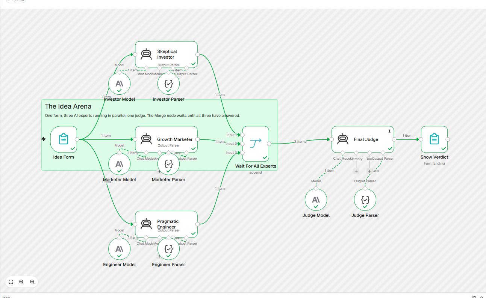

# The Idea Arena

An n8n workflow that reviews startup ideas with AI. You submit an idea in a web form, three AI experts review it at the same time, and a judge returns a verdict with a concrete next step.

## What it does

1. **Idea Form** — a web form asks for the idea and the target customer.
2. **Three experts run in parallel**, each with its own role:
   - **Skeptical Investor** judges whether the idea can make money and names the biggest risk.
   - **Growth Marketer** writes a slogan and picks the best channel to reach customers.
   - **Pragmatic Engineer** suggests a tech stack and estimates the weeks needed to build an MVP (a first working version).
3. **Wait For All Experts** (Merge node) waits until all three have answered.
4. **Final Judge** reads the three opinions and returns a verdict (`Build it`, `Pivot` or `Kill it`), a score from 0 to 100, a one-line summary and a next step for this week.
5. **Show Verdict** displays the result on the form's final page.

## Example result

For the idea "an app that scans your fridge and suggests dinner from items that are about to expire", the judge returned **Pivot, 54/100** and suggested testing the idea by hand with 10 young people living alone before building anything.

## Concepts used

- Form Trigger and Form Ending page
- Parallel branches and the Merge node as a synchronization point
- AI Agent nodes with a role-specific system prompt
- Structured Output Parser, so every AI answer has the same JSON fields
- Prompt-injection guard: each prompt tells the model that the user text is data only

## How to run it

You need [n8n](https://n8n.io) (self-hosted or cloud) and an [Anthropic API key](https://console.anthropic.com).

1. In n8n, create a workflow and choose **Import from File**, then select `idea-arena-workflow.json`.
2. Open each of the four **Model** nodes (`Investor Model`, `Marketer Model`, `Engineer Model`, `Judge Model`) and select your own Anthropic credential. The credential in the file belongs to the original author and will not work for you.
3. Click **Execute workflow**. n8n shows a test URL for the form.
4. Open the form, enter an idea and a customer, and click **Roast my idea**.

Each run makes four AI calls: three with Claude Haiku 5.5 and one with Claude Sonnet 5.5 for the judge.

## Limitations

- Ideas and verdicts are not saved anywhere. A Google Sheet or n8n Data Table step after the judge would add a history.
- The experts only know what you write in the form. They do not search the web for competitors.

## Built with

n8n · Claude (Anthropic API) · n8n Form nodes
